Busco ......... Vaga Jr em Product Design
Base .......... São Paulo, SP
Idiomas ....... Português (nativo) · Inglês (C1)

PROJETO FINAL ──────────────────────────────────────────

<a href="https://elasmapeiam.vercel.app">ElasMapeiam</a> ... Mapa colaborativo de bicicletários em SP
                mostra se o lugar ainda funciona e quando
                isso foi confirmado pela última vez
Pesquisa ...... 144 respostas de ciclistas de SP
                47% já deixaram de ir a algum lugar por
                não saber onde deixar a bike
IA ............ Gemini extrai critérios e tira dados
                pessoais do relato · moderação humana
Stack ......... TanStack Start · Supabase · Leaflet · Vercel
Código ........ <a href="https://github.com/alexsamn/elasmapeiam">github.com/alexsamn/elasmapeiam</a>

HACKATHONS ─────────────────────────────────────────────

Repô .......... Vencedor · Challenge da Reprograma · nov/2026
                IA "bibliotecária" para alunas da Reprograma

Rede Semente .. 1º lugar · WoHackers · ago/2026
                Fundo comunitário em blockchain para
                microempreendedoras comprarem equipamento

<a href="https://selo-raiz.vercel.app">Selo Raiz</a> ..... Festival Compartilhe · ARTIGO 19 + EFF
                Reputação de vendedora que viaja entre
                marketplaces, com consentimento (LGPD)

<a href="https://garimpaai-mvp.replit.app">Garimp.AI</a> ..... Techstars Startup Weekend IA · direção do time
                Agente de IA que conecta artistas
                e colecionadores

ORIGEM ─────────────────────────────────────────────────

10+ anos ...... Desenvolvimento de produto têxtil
Liderei ....... Linha Bike/Ciclismo da Lupo (via L'atelier)
                do conceito à ficha técnica e prova de modelagem
Na prática .... ficha técnica  →  spec de produto
                amostra        →  protótipo
                prova de peça  →  teste com usuário
                fábrica        →  handoff para dev

FORMAÇÃO ───────────────────────────────────────────────

Design de Moda ........ Senac
Análise e Desenv. ..... FIAP
UX .................... Menina de UX (bootcamp)
IA Aplicada ........... Todas em Tech · Reprograma (2026)
Em curso .............. Product Design · Design Circuit

EM ANDAMENTO ───────────────────────────────────────────

01 ............ ElasMapeiam
                validação da IA com 3 avaliadoras e
                teste com ciclistas

02 ............ Repô
                do protótipo vencedor ao app real

NO AR ──────────────────────────────────────────────────

<a href="https://arquivos-de-ux.vercel.app">Arquivos de UX</a>  Glossário de Product Design · 164 termos
                Next.js · Supabase · Vercel

<a href="https://github.com/alexsamn/reprograma-ia-aplicada">Reprograma</a> .... 13 entregas do curso IA Aplicada
                (9 individuais · 4 em grupo)

<a href="https://momotaro.store">Momotaro</a> ...... Loja de roupa de ciclismo · Shopify

FERRAMENTAS ────────────────────────────────────────────

Processo ...... Pesquisa · Wireframe · Protótipo · Teste
Design ........ Figma · Illustrator · Photoshop
Código ........ HTML · CSS · JavaScript · TypeScript
Vibe coding ... Claude Code · Lovable · Supabase · Vercel
Automação ..... Make · agentes com LLM
Web ........... Shopify
IA ............ Claude · ChatGPT · Gemini · FLORA

FORA DO TRABALHO ───────────────────────────────────────

Nasci em ...... Goiânia
Morei no ...... Japão
Pedalo com .... Vespas Bike Gang
Mora comigo ... Mika (a gata da fita métrica)

CONTATO ────────────────────────────────────────────────

Portfólio ..... <a href="https://alexsandramoura.com.br">alexsandramoura.com.br</a>
LinkedIn ...... <a href="https://www.linkedin.com/in/alexsandramoura">in/alexsandramoura</a>
E-mail ........ <a href="mailto:SEU-EMAIL">SEU-EMAIL</a>
</pre>
